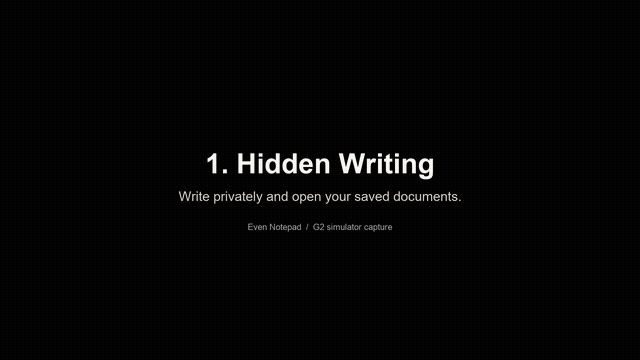

<div align="center">

# EVEN NOTEPAD

**A private writing space for Even Realities G2**

Write on your phone and see your words on your glasses. Stay connected to your terminal, X timeline, and news in the same app.


[Features](#features) · [Getting started](#getting-started) · [Connections](docs/connections.md) · [Architecture](docs/architecture.md) · [Video](docs/media/even-notepad-preview.mp4) · [License](LICENSE)

[](docs/media/even-notepad-preview.mp4)

[Watch the full preview](docs/media/even-notepad-preview.mp4)

</div>

## Features

| Mode | What it does |
| --- | --- |
| **Editor** | Write on your phone while the glasses show your text, cursor, file name, and counts. The phone displays a separate typewriter scene. |
| **Documents** | Create, rename, move, and delete documents and folders from the paper clip menu. |
| **Even Terminal** | Choose a session on the glasses, send prompts from the phone, and scroll through the conversation. |
| **X (Twitter)** | Read your timeline on the glasses using your own X credentials. |
| **News** | Browse RSS news with sources selected for the phone language. |

The preview illustrates the app and simulator display; it is not a recording of the actual view through G2 glasses. Phone keyboard behavior, glasses input, and connection availability depend on the device and environment.

## Getting started

Install Node.js 25 and the project dependencies, then start the local development server:

```sh
npm ci
npm run dev
```

To build and package for Even Hub:

```sh
npm run typecheck
node --test tests/*.test.js
npm run pack
```

The simulator command is `npm run sim` while the development server is running. For connection setup and official links, see [Connections](docs/connections.md). For design and implementation details, see [Architecture](docs/architecture.md) and [Development](docs/development.md).

## Connection and data notes

Documents and connection settings are stored through the Even App SDK, or browser storage in standalone use. Clearing application data can remove them. The SDK storage used for tokens is not documented as encrypted credential storage. The packaged app can connect only to origins permitted in [app.json](app.json); a different address requires a rebuilt package. [Private build setup](docs/connections.md#private-terminal-build) keeps personal addresses out of Git. X access depends on the user's API plan and credentials. X access and refresh tokens are sent to the configured relay; review [relay and privacy notes](docs/connections.md#relay-and-privacy) before connecting.

## Project status

This is a development project. Application source is written in TypeScript and checked in strict mode. Simulator results and a promotional preview do not replace testing on an iPhone, G2 glasses, and a ring. See [Development](docs/development.md) for verification scope and known limitations.

Even Notepad is an independent project and is not affiliated with or endorsed by Even Realities.

## License and third-party materials

Project-original code and materials are available under the [MIT License](LICENSE). The Even Hub CLI is a separate proprietary dependency; its package license permits installation to build and submit EvenHub applications. Even Realities, X, Tailscale, and their marks belong to their respective owners. Guide screenshots show third-party interfaces and documentation; their inclusion does not grant rights to those materials.
